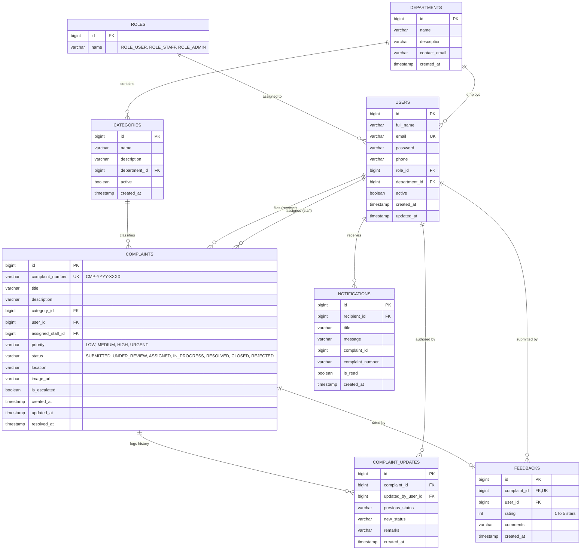

# Online Complaint Management System (Resolvify)

A modern, simple, and beautiful full-stack web application for grievance logging, automated workflow routing, SLA escalation, and transparent issue tracking.

Built with **React (Vite) + Tailwind CSS** on the frontend and **Spring Boot 3 + Spring Security (JWT) + Spring Data JPA** on the backend.

---

## 🌟 Key Features

- **Modern SaaS Aesthetics**: Soft shadows, generous whitespace, rounded-2xl cards, smooth hover transitions, and Inter typography.
- **Dark / Light Mode**: Seamless theme switching persisted in `localStorage`.
- **Role-Based Access Control (RBAC)**:
  - **Citizen / User**: File complaints with image uploads, monitor ticket status, view chronological progress, rate resolved tickets with 1-5 star ratings.
  - **Support Staff**: View assigned tickets, update state (`IN_PROGRESS`, `RESOLVED`, `REJECTED`), and document resolution remarks.
  - **Administrator**: Comprehensive analytics dashboard, unassigned complaint triage, user account management, category administration, and CSV audit reports.
- **Visual Status Timeline**: Interactive milestone nodes with color-coded badges, timestamps, and staff commentary on the Track page.
- **7-Day SLA Escalation**: Unresolved tickets exceeding 7 days are automatically flagged as escalated with supervisor alerts.
- **In-App Notification Center**: Instant bell alerts on status changes and staff assignments with unread counters.
- **Interactive Visualizations (Recharts)**:
  1. Departmental Category Distribution (Pie Chart)
  2. Monthly Submission Volume Trends (Line Chart)
  3. Average Turnaround Resolution Days by Department (Bar Chart)
- **One-Click CSV Export**: Instant report generation for administrative reporting.
- **H2 & MySQL Ready**: Runs out-of-the-box with embedded in-memory H2 database; switchable to MySQL via `application.properties`.

---

## 🏗 System Architecture & Folder Structure

```
project 33/
├── backend/                               # Spring Boot 3 Backend
│   ├── mvnw.cmd / mvn.cmd                 # Maven execution wrappers
│   ├── pom.xml                            # Dependencies (Security, JPA, JWT, H2, MySQL)
│   └── src/main/
│       ├── java/com/complaint/system/
│       │   ├── ComplaintSystemApplication.java
│       │   ├── config/                    # SecurityConfig, WebMvcConfig, DataInitializer
│       │   ├── controller/                # Auth, Complaint, Category, User, Staff, Feedback, Report
│       │   ├── dto/                       # Request & Response Data Transfer Objects
│       │   ├── entity/                    # User, Role, Complaint, Category, Department, etc.
│       │   ├── enums/                     # RoleType, ComplaintStatus, Priority
│       │   ├── exception/                 # GlobalExceptionHandler, Custom Exceptions
│       │   ├── repository/                # Spring Data JPA Repositories
│       │   ├── security/                  # JwtUtils, AuthTokenFilter, CustomUserDetails
│       │   └── service/                   # Core business logic & storage handlers
│       └── resources/
│           ├── application.properties     # H2 & MySQL configuration profiles
│           └── data.sql                   # Database initialization script
│
└── frontend/                              # React 18 + Vite Frontend
    ├── package.json                       # Dependencies (Tailwind, Lucide, Axios, Recharts)
    ├── vite.config.js                     # Vite proxy & development server config
    ├── tailwind.config.js                 # Theme palette & typography customization
    ├── index.html                         # Google Fonts (Inter) & root template
    └── src/
        ├── App.jsx                        # Role-based route definitions
        ├── main.jsx                       # Providers (Theme, Auth, Toast, Router)
        ├── components/                    # Navbar, Sidebar, Badges, Timeline, Modal, Ratings
        ├── context/                       # AuthContext, ThemeContext, ToastContext
        ├── pages/                         # Landing, Login, Register, Dashboards, Reports, Profile
        └── services/                      # Axios client with JWT interceptor
```

---

## 📊 Entity Relationship Diagram (ERD)



---

## 👥 Demo Accounts

The database comes pre-seeded with three demo accounts for instant evaluation:

| Role | Email | Password | Primary Capabilities |
| :--- | :--- | :--- | :--- |
| **Administrator** | `admin@demo.com` | `Admin@123` | Assign staff, view analytics, manage users & categories, export CSV |
| **Staff Member** | `staff@demo.com` | `Staff@123` | Inspect assigned tickets, update status (`IN_PROGRESS`, `RESOLVED`, `REJECTED`) |
| **Citizen / User** | `user@demo.com` | `User@123` | File grievances with photo uploads, track tickets, provide star ratings |

*Quick login buttons are available directly on the `/login` page to prefill credentials with a single click.*

---

## 🚀 Setup & Execution Guide

### Prerequisites
- **Java 17+** (Targeted for Spring Boot 3.3.5)
- **Node.js 18+** & npm

### 1. Backend Setup
```bash
cd backend

# Build and run the Spring Boot application (runs on http://localhost:8081)
mvn spring-boot:run
# OR run the pre-built executable jar:
java -jar target/complaint-system-backend-1.0.0.jar
```
*The H2 console is available at `http://localhost:8081/h2-console` (JDBC URL: `jdbc:h2:mem:complaintdb`, Username: `sa`, Password: blank).*

#### Switching to MySQL (Optional)
In `backend/src/main/resources/application.properties`, uncomment the MySQL block and configure your MySQL server credentials:
```properties
spring.datasource.url=jdbc:mysql://localhost:3306/complaint_system_db?useSSL=false&serverTimezone=UTC&allowPublicKeyRetrieval=true
spring.datasource.username=root
spring.datasource.password=yourpassword
spring.datasource.driverClassName=com.mysql.cj.jdbc.Driver
spring.jpa.database-platform=org.hibernate.dialect.MySQLDialect
```

---

### 2. Frontend Setup
```bash
cd frontend

# Install dependencies
npm install

# Start the Vite development server (runs on http://localhost:5173)
npm run dev
```

Open your browser at **`http://localhost:5173`**.

---

## 📡 REST API Documentation

### Authentication (`/api/auth`)
| Method | Endpoint | Description | Auth Required |
| :--- | :--- | :--- | :--- |
| `POST` | `/api/auth/register` | Register a new user | Public |
| `POST` | `/api/auth/login` | Authenticate and obtain JWT token | Public |
| `GET` | `/api/auth/me` | Retrieve profile of authenticated user | Bearer Token |

### Complaints (`/api/complaints`)
| Method | Endpoint | Description | Auth Required |
| :--- | :--- | :--- | :--- |
| `POST` | `/api/complaints` | File a complaint (Multipart: title, category, priority, location, image) | Bearer Token |
| `GET` | `/api/complaints` | List complaints (Filtered by role: User -> own; Staff -> assigned; Admin -> all) | Bearer Token |
| `GET` | `/api/complaints/{id}` | Retrieve complaint by ID | Bearer Token |
| `GET` | `/api/complaints/track/{number}` | Public / Authenticated tracking with status history | Public |
| `PUT` | `/api/complaints/{id}/assign` | Assign complaint to staff member | Admin Only |
| `PUT` | `/api/complaints/{id}/status` | Update complaint status & resolution remarks | Staff / Admin |

### Categories (`/api/categories`)
| Method | Endpoint | Description | Auth Required |
| :--- | :--- | :--- | :--- |
| `GET` | `/api/categories` | List all categories | Public |
| `GET` | `/api/categories/active` | List only active categories | Public |
| `POST` | `/api/categories` | Create new category | Admin Only |
| `PUT` | `/api/categories/{id}` | Update category metadata | Admin Only |
| `DELETE` | `/api/categories/{id}` | Delete category | Admin Only |

### Feedback & Notifications
| Method | Endpoint | Description | Auth Required |
| :--- | :--- | :--- | :--- |
| `POST` | `/api/feedback/{complaintId}` | Submit 1-5 star rating and comment on resolved ticket | User Only |
| `GET` | `/api/feedback/{complaintId}` | Fetch feedback record for complaint | Bearer Token |
| `GET` | `/api/notifications` | Fetch user notifications | Bearer Token |
| `GET` | `/api/notifications/unread-count` | Get count of unread notifications | Bearer Token |
| `PUT` | `/api/notifications/{id}/read` | Mark single notification as read | Bearer Token |
| `PUT` | `/api/notifications/read-all` | Mark all user notifications as read | Bearer Token |

### Reports & Analytics (`/api/reports`)
| Method | Endpoint | Description | Auth Required |
| :--- | :--- | :--- | :--- |
| `GET` | `/api/reports/dashboard` | Aggregated KPIs and chart datasets | Admin Only |
| `GET` | `/api/reports/export/csv` | Download complete complaints CSV audit spreadsheet | Admin Only |

---

## 🎨 Visual Features & Walkthrough

1. **Landing & Instant Tracking**: Clean hero header with quick track input. Users can immediately look up any ticket ID like `CMP-2026-0001` without logging in.
2. **Citizen Dashboard**: Stat cards, recent complaints, fast grievance submission with image drag-and-drop.
3. **Track Complaint Timeline**: Vertical line connecting status nodes with author badge and resolution remarks.
4. **Staff Workspace**: Focused view of assigned tickets with inline status update modal and remark logger.
5. **Admin Operations**: Three interactive Recharts visualizations (Pie, Line, Bar), staff assignment modals, user account toggle, and category management.
6. **Dark Mode**: High contrast, accessible dark theme tailored with Tailwind CSS.
